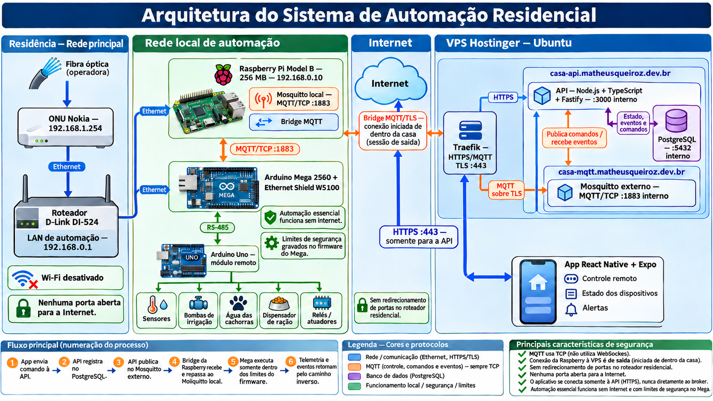

# Automacao residencial



## Arquitetura decidida

- Raspberry Pi Model B (256 MB): gateway MQTT local, sem Node.js e sem Docker.
- VPS Hostinger: API Node.js + TypeScript + Fastify, banco de dados, MQTT externo e HTTPS.
- Aplicativo: React Native com Expo.
- Arduino Mega: controlador central e autonomo.
- Arduino Uno: modulo remoto ligado ao Mega por RS-485.
- Ethernet Shield: W5100 ligado ao Mega.
- Nenhuma porta aberta nos roteadores residenciais.
- Automacoes essenciais continuam funcionando sem Raspberry, VPS ou internet.
- Comandos remotos nunca podem ultrapassar os limites de seguranca gravados no firmware do Mega.

## Rede local de automacao

- Roteador interno: D-Link DI-524 (`192.168.0.1`).
- Raspberry Pi / Mosquitto local: `192.168.0.10:1883`.
- Mega/W5100: endereco obtido por DHCP; inicia conexoes para a Raspberry.
- A futura ponte MQTT sera iniciada pela Raspberry em direcao a VPS usando TLS.

## Monorepo

O projeto usa npm workspaces e Turborepo:

```text
apps/
  api/          API Node.js, TypeScript e Fastify
  casa-app/     aplicativo universal React Native + Expo
packages/
  api-client/   cliente HTTP universal e validado
  contracts/    contratos e schemas compartilhados
  eslint-config/
  typescript-config/
deploy/         infraestrutura Docker local e da VPS
firmware/       códigos do Mega e do Uno
```

Comandos principais, executados na raiz:

```bash
npm install
npm run dev
npm run check
```

`npm run dev` garante que PostgreSQL e Mosquitto estejam ativos no Docker e
inicia, com hot reload:

- API local: `http://127.0.0.1:3001`;
- Expo/Metro: `http://127.0.0.1:8081`.

Use `Ctrl+C` para encerrar API e Expo. Os serviços de infraestrutura continuam
ativos; quando quiser encerrá-los, execute `npm run infra:down`.

Também é possível iniciar somente um consumidor com `npm run dev:api` ou
`npm run dev:app`.

O aplicativo usa Better Auth com sessões persistidas no PostgreSQL. No celular,
os cookies de sessão ficam no Expo SecureStore; nenhum segredo compartilhado é
incluído no bundle.

Antes da primeira execução autenticada, configure em `deploy/.env`:

```dotenv
BETTER_AUTH_SECRET=uma-chave-aleatoria-com-pelo-menos-32-caracteres
BETTER_AUTH_URL=http://IP_DO_COMPUTADOR:3001
AUTH_TRUSTED_ORIGINS=casaautomacao://,exp://,exp://**,exp://192.168.*.*:*/**,http://localhost:*,http://127.0.0.1:*
```

Depois, prepare o banco e crie o primeiro administrador. O comando solicitará
a senha sem gravá-la no repositório:

```powershell
npm run infra:up
npm run db:migrate --workspace @casa/api
npm run auth:create-admin --workspace @casa/api -- --email seu-email@exemplo.com --name "Matheus Queiroz" --role admin
```

A API segue fronteiras de domínio, aplicação, infraestrutura e apresentação. A
decisão e seus limites estão registrados em
[`docs/adr/0001-turborepo-clean-architecture.md`](docs/adr/0001-turborepo-clean-architecture.md).
A abordagem de TDD e os níveis de verificação estão em
[`docs/testing-strategy.md`](docs/testing-strategy.md).

## Estado atual

- Mosquitto local instalado e ativo.
- Autenticacao MQTT habilitada.
- Usuario MQTT do Mega criado.
- IP da Raspberry reservado no DI-524.
- Proxima etapa: validar Mega + W5100 + MQTT sem conectar atuadores.

## Marco validado

- Comunicacao bidirecional Raspberry/Mosquitto/W5100/Mega validada.
- DNS da API e do MQTT externo apontando para a VPS.
- Stack isolado da VPS preparado em `deploy/` e `apps/api/`.
- Aplicativo universal Expo criado em `apps/casa-app`, com dashboard responsivo e identidade visual alinhada ao site pessoal.
- Autenticação Better Auth integrada ao Fastify e ao Expo SecureStore, com cadastro público desabilitado.
- PostgreSQL gerenciado no Neon escolhido para produção; Docker local permanece para desenvolvimento.

